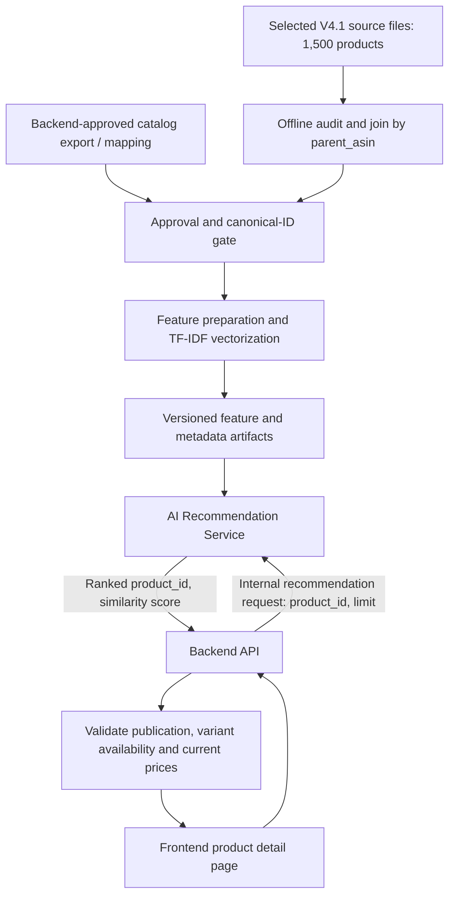

# SWE-63 — Recommendation System Architecture

**Project:** SWE Group 03 — E-commerce Recommendation System  
**Status:** Proposed design — pending Backend integration review  
**Catalog scope:** 1,500 selected products  
**Input specification:** [SWE-62 Recommendation Data Requirements](SWE-62-recommendation-data-requirements.md)  
**Algorithm design:** [SWE-64 Recommendation Baseline Design](SWE-64-recommendation-baseline-design.md)  
**Last updated:** 2026-10-31

## 1. Architecture decision

Build an independent AI recommendation component for **product-to-product similarity**. The first baseline uses TF-IDF and cosine similarity on product content. A versioned **offline indexing process** builds artifacts; a lightweight **online serving process** retrieves Top-K candidates. Backend remains the sole authority for canonical product IDs, published product status, approved media, price, variants and stock.

**In scope:** Similar-product endpoint, catalog-to-index pipeline, candidate retrieval, Backend eligibility filtering, observability and reproducible artifacts.  
**Out of scope:** Collaborative filtering, real-time personalization, production model training on user events, AI ownership of pricing/inventory, unverified Amazon candidate publication.

## 2. Logical architecture



The Backend export and mapping are **proposed interfaces, not verified existing implementations**. Before Backend approval, the same offline pipeline may run in a **research-only mode** using `parent_asin`, without making the results publicly available or claiming those are sellable product IDs.

## 3. Components and responsibilities

| Component | Responsibility | Primary inputs/outputs |
| --- | --- | --- |
| Dataset validator | Validate selection size, unique IDs, join integrity, missingness and approval flags. | V4.1 JSONL/CSV → validation report. |
| Catalog adapter | Convert source records to a stable model-ready schema and resolve Backend ID mapping when approved. | Source records + approved mapping → normalized records. |
| Feature builder | Construct normalized name/description text; optionally add verified or experimental spec features. | Normalized records → feature text. |
| Index builder | Fit TF-IDF, persist sparse feature matrix, ID-order mapping and manifest. | Feature text → versioned artifacts. |
| Recommendation service | Load an index once, retrieve/filter candidates, sort deterministically, return Top-K. | Canonical product ID → list of canonical product IDs + scores. |
| Backend catalog gateway | Authoritative product hydration and eligibility check, including price/stock. | Ranked IDs → publicly displayable catalog items. |

**Boundary rule:** The AI service does not read or modify commerce orders, inventory, payment, or product pricing and does not expose unapproved Amazon records as public listings.

## 4. Offline pipeline

1. **Select and validate subset:** Require exactly 1,500 unique selected `parent_asin` values and record dataset hash/version. The supplied historical 10,000-row reports are *not* the audit for this subset.
2. **Join:** Merge `catalog_products_v4_1.jsonl` with `catalog_specifications_v4_1.jsonl` on `parent_asin`. Fail on duplicate product IDs; report missing specifications without fabricating values.
3. **Preserve provenance:** Keep original source ID, source version, approval state and meaningful reasons/evidence. Parse optional `features_json` safely if used.
4. **Separate modes:** Research mode may index unverified source candidates but is **not served publicly**. Production mode requires approved Backend identity mapping and listing eligibility.
5. **Prepare text:** Normalize whitespace/case where appropriate; retain meaningful model numbers and capacity units. Fall back to name-only when description is missing.
6. **Build baseline representation:** Fit one TF-IDF vectorizer on the approved indexing set; store sparse vectors and the exact row-to-product-ID order.
7. **Validate and publish artifacts:** Record build timestamp, code version, dataset SHA-256, item count, feature configuration, input schema version and evaluation summary; publish via atomic version switch.

**Artifacts (proposed):** `tfidf_vectorizer`, `product_features.npz`, `id_mapping.json`, `index_manifest.json`. The names are a design convention, not files currently present.

## 5. Online serving flow

1. Frontend displays a product detail page through Backend.
2. Backend requests similar products from the internal AI endpoint with its canonical `product_id` and `limit`.
3. AI resolves the index row, restricts candidate pool to an allowed/reviewed category if available, computes cosine similarity, removes the query product and duplicates, and returns more candidates than requested when needed for downstream filtering.
4. Backend verifies each candidate against **current** published state, sellable variant availability, approved media and displayed price, then returns up to `limit` valid products to Frontend.
5. If fewer than `limit` eligible products remain, Backend may return fewer; AI must not invent replacements. A separately defined fallback is optional.

### 5.1 Proposed internal API contract

**Endpoint:** `POST /internal/recommendations/similar` (proposal; coordinate naming/authentication with Backend). Only Backend should call this internal endpoint.

Request example (illustrative IDs):

```json
{
  "product_id": "backend-product-123",
  "limit": 5
}
```

Success response:

```json
{
  "product_id": "backend-product-123",
  "index_version": "reco-tfidf-v1",
  "recommendations": [
    {"product_id": "backend-product-456", "score": 0.82},
    {"product_id": "backend-product-789", "score": 0.76}
  ]
}
```

**Semantics:** `score` is a similarity score, **not** a purchase probability. Product IDs are canonical Backend IDs and may only be emitted once an approved mapping exists. Scores and IDs are illustrative, not measured outputs. No price or stock is returned by AI.

**Validation and errors (proposal):** `limit` must be a positive bounded integer (suggest default 5, maximum 20); malformed requests return `400`, unknown/non-indexed product IDs return `404`, and index temporarily unavailable returns `503`. Successful requests may return an empty `recommendations` array when no eligible similarity candidates exist. Include correlation/request IDs in internal logs without exposing sensitive data.

**Security:** Backend-to-AI service authentication, internal network exposure, least-privilege access and request limits are required for deployment. Exact mechanism must align with existing infrastructure.

## 6. Consistency, updates and failure handling

- **Catalog changes:** Rebuild the small 1,500-product index on a scheduled or release-triggered approved export. Incremental indexing is not necessary for the first design.
- **Deletion/unpublication:** Backend filters out unapproved, deleted, out-of-stock or non-sellable products at serving time, even if the AI index is stale; remove them from the next index build.
- **Source-to-Backend mapping missing:** Do not serve a source-only product publicly; exclude or return no recommendation until mapping is resolved.
- **Model artifacts unavailable:** AI returns a controlled error; Backend renders no recommendation module or uses an independently approved fallback. Do not block purchase or product detail display.
- **Small candidate pools:** Return fewer than `K` rather than crossing into inappropriate categories without an explicit policy.
- **Research vs production:** Test outputs may include `parent_asin` only in research tooling; production contract always returns Backend `product_id`.

## 7. Quality, performance and observability

At 1,500 products, **sparse on-demand cosine retrieval** is sufficiently simple for a baseline; a dedicated vector database and a full `1,500 × 1,500` similarity cache are not required. Optimize only after measuring latency and load.

Observe: index version and record count, missing ID-map rate, requests, p50/p95 latency, response errors, empty-result rate, downstream filter rate, and fallback usage. Log internal IDs only when necessary; do not log search text or personal event payloads by default. Benchmark targets and deployment SLOs must be agreed with the Backend/deployment team before labeling them acceptance requirements.

## 8. Design alternatives and trade-offs

| Option | Decision | Rationale |
| --- | --- | --- |
| TF-IDF + cosine on product text | **Select as baseline** | Explainable, fast, appropriate without user history. |
| Dense text embeddings | Deferred | May better match semantic similarity but adds infrastructure and cost; evaluate against baseline first. |
| Collaborative filtering | Deferred | Requires reliable user-item interaction data not included in supplied files. |
| Separate vector database | Not required for MVP | Unnecessary operational complexity for 1,500 products. |
| Direct AI database access | Avoid by default | Couples services and duplicates catalog ownership; prefer documented export/API. |

## 9. Open decisions to resolve with Backend

- Canonical `product_id` mapping and lifecycle from `parent_asin`.
- Approved catalog feed shape, refresh frequency and authorization.
- Product-vs-variant recommendation semantics and eligible product policy.
- Internal endpoint path, authentication method, timeout, error handling and response hydration contract.
- Which categories are sufficiently verified to apply strict same-category filtering.

## 10. Deliverable and definition of done

**Deliverable:** This Recommendation System Design document.

- [x] Define service boundaries, offline indexing and online retrieval.
- [x] Propose an internal AI–Backend API and failure semantics.
- [x] Define versioning, refresh, observability and eligibility safeguards.
- [x] Document design alternatives and dependencies on SWE-62.
- [ ] Review Backend contract and product/variant ID assumptions.
- [ ] Validate deployment interface against the actual AI repository architecture.
- [ ] Obtain team design approval.

**Task status recommendation:** Architecture documentation drafted; keep review items open until confirmed. This document **does not** assert that the API or model has already been implemented.
