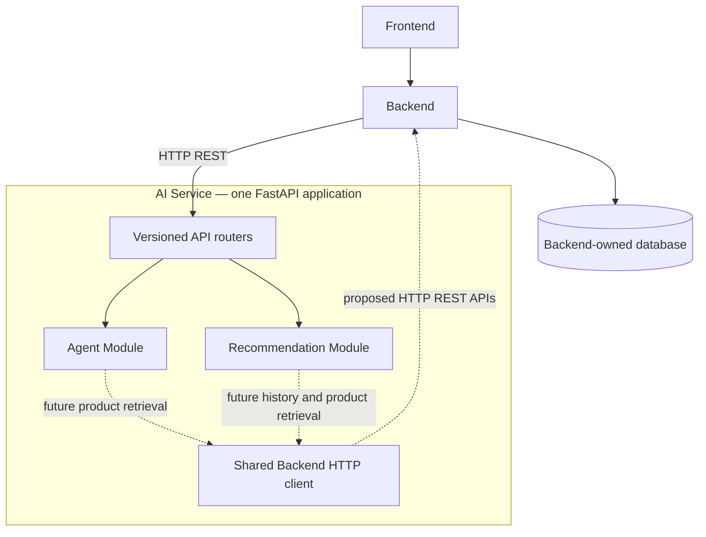

# Architecture

One FastAPI process and one AI container host both feature modules.

Solid arrows show the intended request entry path; dotted arrows are future
integrations. Currently both feature endpoints return placeholders and make no
outbound requests. The diagram does not imply an existing Backend API contract.

## Ownership and module boundaries

| Component | Responsibility |
| --- | --- |
| Frontend repository | Customer interface; calls Backend |
| Backend repository | Authentication, authorization, users, products, categories, inventory, orders, payments, carts, promotions, search history and interaction tracking |
| AI `api/v1/` | API versioning, router composition and process health |
| AI `recommendation/` | Request/response schemas, HTTP endpoint and future recommendation logic |
| AI `agent/` | Placeholder HTTP endpoint, request-local conversation models and independent bounded shopping-agent core |
| AI `integrations/` | Reusable async Backend HTTP configuration and independent LLM connection layer |
| AI `core/` | Environment settings and standard Python console logging |
| AI `main.py` | Single application, lifecycle and entry point |

Routers call feature service functions. Feature modules do not import each other.
HTTP-facing service functions currently only construct placeholder responses. The
independent `ShoppingAgent` core consumes the provider-independent LLM protocol;
the chat router does not invoke it yet.

## Communication and lifecycle

1. Frontend sends customer requests to Backend.
2. Backend authenticates and authorizes the user and calls the internal AI API.
3. The AI router validates the payload and delegates to its feature service.
4. Today the service returns `status: not_implemented` without any external call.
5. Later, AI can request Backend-owned products/history through agreed HTTP APIs.

The lifespan initializes logging and opens separate Backend and LLM HTTPX pools.
Constructing the pools makes no network calls; shutdown closes both. Health is a
liveness endpoint and does not claim that recommendations, an LLM, or Backend are
operational.

The Backend client uses a configurable HTTP(S) base URL and positive timeout,
reuses connections, and raises `httpx.HTTPStatusError` for non-success responses.
Timeouts and network failures remain `httpx.TimeoutException`/`httpx.RequestError`.
There are no automatic retries. When real calls are introduced, feature code must
translate failures into an agreed API error response without exposing Backend
payloads or credentials. No current feature endpoint uses this client.

The [SWE-69 Agent–Backend contract proposal](backend-api-contract-proposal.md) and
[draft payload schema](schemas/backend-api-contract-proposal.schema.json) describe
a review target, not deployed Backend routes or approved changes. Auth, route
mapping, correlation, budgets and generated chat/error responses still require
both teams' agreement and implementation. CURRENT placeholder behavior remains
authoritative; the proposal does not enable a real product provider.

### LLM connection layer

`integrations/llm/` separates the `LLMClient` protocol, typed text messages and
responses, connection exceptions, and `OpenAICompatibleLLMClient` implementation.
The adapter posts non-streaming Chat Completions requests using HTTPX and validates
the provider envelope with Pydantic before returning an assistant response.
Unrecognized provider metadata is ignored; invalid or non-text responses raise a
controlled error. Tool calling uses the separate optional interface described below.

`create_llm_client()` is an async context manager that owns the adapter's HTTP
pool. FastAPI exposes the adapter as `app.state.llm_client`; standalone callers
can use the same context manager. API keys use `SecretStr`, and key/base URL/model
are optional at startup but required before invocation. HTTP errors, network
failures, timeouts and malformed responses map to provider-independent exceptions
without raw provider bodies or credentials. There are no retries or redirects.
The client does not call Backend, orchestrate an agent or change endpoint behavior.

### Shopping-agent foundation

`agent/orchestrator.py` owns `ShoppingAgent`, injected with `LLMClient`. It has no
HTTP or Backend dependency and creates no client pool. Callers own the injected
client's lifecycle. The public `agent/service.py:chat` function remains a
placeholder, preserving the current API response and error contract.

`AgentTurn` and `ConversationMessage` in `agent/conversation.py` are internal,
immutable per-request contracts. History consists of completed user/assistant
pairs, followed by the current user message. The prompt builder prepends a trusted,
versioned system prompt and copies messages for each call. It stores no history,
including when requests share a session ID; IDs are opaque metadata, never an
authorization or persistence mechanism. Caller-supplied system messages are not
accepted. Callers remain responsible for selecting authorized history.

The core without tools allows one LLM call, no retries, a default 30-second overall
async deadline, 20 history messages, 4,000 characters in the current message,
32,000 input characters including system context and 8,000 model-reply characters.
Budgets reject excess input/replies rather than truncating them. Reply size is a
post-generation check, not a provider token limit. Invalid schemas use Pydantic
validation; invalid order/budgets, LLM errors, incomplete/invalid replies,
unsupported capabilities and deadline expiry have controlled agent exceptions.
Cancellation from the caller is preserved. The core does not log messages or
provider details.

Without catalog access, the system prompt requests general guidance and clarifying
questions. Every `AgentResult.answer` has a fixed unavailable/unverified catalog
notice, and `catalog_verified` is always false. This labels advice as unverified;
it does not prove model factuality. Grounded product/price/stock answers require
authoritative Backend tools and separate evaluation before public integration.

### Read-only tool calling — SWE-68

`ToolRegistry` exposes names, generated definitions and validated async dispatch.
`create_product_tools(provider)` registers `search_products` and `get_product_details`
against an injected `ProductProvider`. Without a provider it returns explicit
`not_available` results. Only fake/unavailable sources are supported in this phase;
no Backend URLs, database access or business actions are implemented.

`LLMClient.complete()` retains its text-only contract. The optional
`ToolCallingLLMClient.complete_with_tools()` adds typed assistant function calls and
tool-result messages associated by call ID. The HTTPX adapter serializes these to
Chat Completions tools. Tool-mode response envelopes are capped at 64 KiB before
JSON validation; this is a post-download check, not a streaming transport limit.

With a nonempty registry, the agent makes at most two tool rounds and three LLM
calls, with at most two calls per reply and four calls total. Execution is
sequential; each tool has a five-second default timeout within the overall agent
deadline. The final model turn forbids tools. Duplicate/replayed call IDs,
inconsistent replies and exceeded budgets stop processing. Registry errors are
bounded structured tool results, allowing correction without unbounded retries.
Tool-mode context accounting includes serialized schemas, arguments, IDs and results.

Only allowlisted product fields are returned. Arguments are at most 4 KiB; results
at most 8 KiB; search is limited to five products. Product text and specifications
have size/control-character validation; extra provider fields are discarded.
Free text remains untrusted data, not a semantic prompt-injection filter. Error
payloads contain fixed codes, never exception details. Fake data does not change
`catalog_verified=False` or the catalog-unavailable notice. See [tools](tools.md)
for the provider boundary to implement after SWE-69 approval.

### Prompt structure

`agent/prompts/system.py` defines `SYSTEM_PROMPT_VERSION` and a concise Vietnamese-first
`SYSTEM_PROMPT`. Version 1.1.0 selects trusted no-tool/tool-capable context through
`system_prompt(with_tools=...)`. It covers needs discovery, explanation and evidence-based comparisons,
grounding, unavailable capabilities, privacy, permitted actions and untrusted input.
`prompts/builder.py:build_messages()` validates history order and constructs fresh
`LLMMessage` objects: one trusted system message, completed user/assistant pairs,
and the current user message. User content is never formatted into system text or
parsed for role markers. Session IDs remain outside model context. The orchestrator
checks its existing total input budget after assembly, including the system prompt.

The prompt is configured in trusted source constants and versioned in Git; there
is no prompt framework, runtime template engine or user-selectable system policy.
Tool results are appended under the tool role with call association and source
labels, preserving the distinction between untrusted data and system instructions;
see [prompt guidance](prompts.md). Unit tests check policy
presence and assembly, while the documented manual evaluation checks live model
behavior separately. The chat HTTP contract remains the existing placeholder.

## Deployment

Development Compose defines only AI and publishes port 8001 on loopback.
The image binds to `0.0.0.0`, runs as UID 10001, and contains a locked Python 3.12
runtime environment. The image is reusable by the deployment repository.

Production initially uses one VPS and a separate root Compose configuration for
Backend, AI and the Backend-managed database as appropriate. Both applications
share an internal Docker network: Backend calls `http://ai:8001`, and AI uses an
agreed Backend address such as `http://backend:8000`. `localhost` inside a container
refers to that container itself. Do not publish AI ports or route it through the
public reverse proxy. Decide service authentication with Backend before release.

## Future extension points

- Recommendation service: personalized, search/view-based and similarity ranking
  once data access and evaluation requirements are agreed.
- Agent HTTP integration: connect the tested core after generated-answer payloads,
  grounding expectations and error mappings are agreed.
- Agent prompts/tools: add only the prompts and Backend product tools required by
  the first implemented use case.
- Backend integration: add concrete methods only after endpoint paths, payloads,
  authorization and failure behavior are agreed.

No extension currently requires another application/container, direct database
access, a queue, vector database or ML framework.
