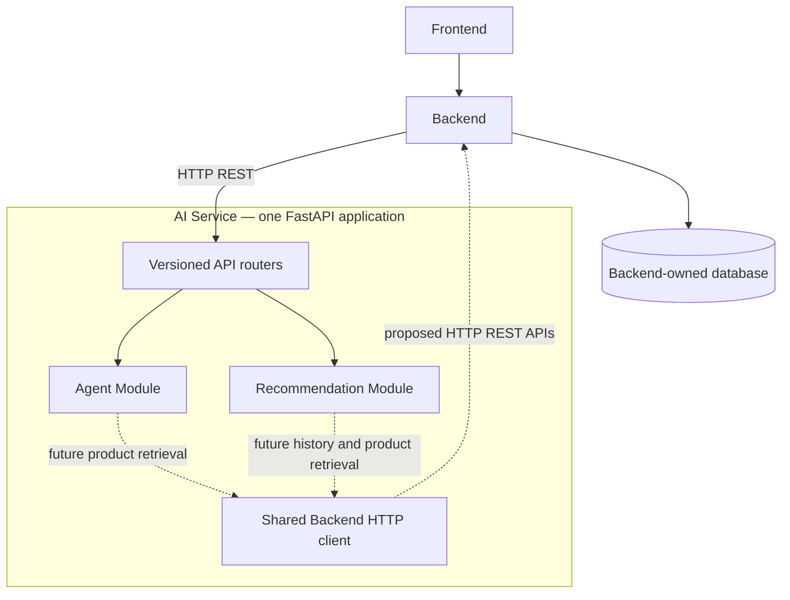

# Architecture

One FastAPI process and one AI container host both feature modules.

Solid arrows show the intended request entry path; dotted arrows are future
integrations. Currently both feature endpoints return placeholders and make no
outbound requests. The diagram does not imply an existing Backend API contract.

## Ownership and module boundaries

| Component | Responsibility |
| --- | --- |
| Frontend repository | Customer interface; calls Backend |
| Backend repository | Authentication, authorization, users, products, categories, inventory, orders, payments, carts, promotions, search history and interaction tracking |
| AI `api/v1/` | API versioning, router composition and process health |
| AI `recommendation/` | Request/response schemas, HTTP endpoint and future recommendation logic |
| AI `agent/` | Request/response schemas, HTTP endpoint and future shopping assistance; reserved prompts/tools directories |
| AI `integrations/` | Reusable async HTTP client configuration for Backend |
| AI `core/` | Environment settings and standard Python console logging |
| AI `main.py` | Single application, lifecycle and entry point |

Routers call feature service functions. Feature modules do not import each other.
Services currently only construct placeholder responses. No additional repository,
manager or abstract interface layer is needed at this stage.

## Communication and lifecycle

1. Frontend sends customer requests to Backend.
2. Backend authenticates and authorizes the user and calls the internal AI API.
3. The AI router validates the payload and delegates to its feature service.
4. Today the service returns `status: not_implemented` without any external call.
5. Later, AI can request Backend-owned products/history through agreed HTTP APIs.

The lifespan initializes logging and opens one HTTPX client pool. Constructing the
pool does not contact Backend; shutdown closes it. Health is a liveness endpoint
and does not claim that recommendations, an LLM, or Backend are operational.

The Backend client uses a configurable HTTP(S) base URL and positive timeout,
reuses connections, and raises `httpx.HTTPStatusError` for non-success responses.
Timeouts and network failures remain `httpx.TimeoutException`/`httpx.RequestError`.
There are no automatic retries. When real calls are introduced, feature code must
translate failures into an agreed API error response without exposing Backend
payloads or credentials. No current feature endpoint uses this client.

## Deployment

Development Compose defines only AI and publishes port 8001 on loopback.
The image binds to `0.0.0.0`, runs as UID 10001, and contains a locked Python 3.12
runtime environment. The image is reusable by the deployment repository.

Production initially uses one VPS and a separate root Compose configuration for
Backend, AI and the Backend-managed database as appropriate. Both applications
share an internal Docker network: Backend calls `http://ai:8001`, and AI uses an
agreed Backend address such as `http://backend:8000`. `localhost` inside a container
refers to that container itself. Do not publish AI ports or route it through the
public reverse proxy. Decide service authentication with Backend before release.

## Future extension points

- Recommendation service: personalized, search/view-based and similarity ranking
  once data access and evaluation requirements are agreed.
- Agent service: provider integration and orchestration when a provider is chosen.
- Agent prompts/tools: add only the prompts and Backend product tools required by
  the first implemented use case.
- Backend integration: add concrete methods only after endpoint paths, payloads,
  authorization and failure behavior are agreed.

No extension currently requires another application/container, direct database
access, a queue, vector database or ML framework.
